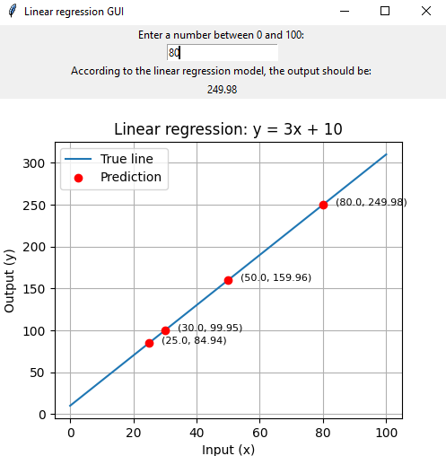
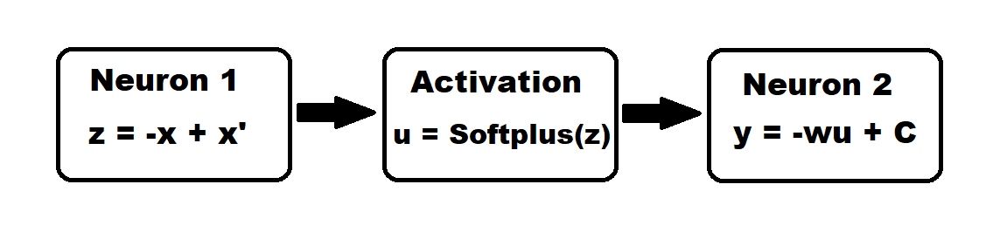
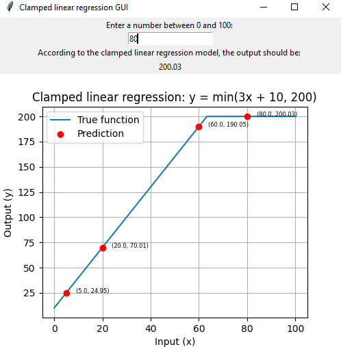

# Deep Network Development - Fall 2026 - Practice
In this repo I aim to create various small, self-contained machine learning / neural network projects, neatly organised into separate folders. The goal here is to prepare and practice for this semester's Deep Network Development classes, assignment work and coding tests as part of my Autonomous Systems Computer Science Masters programme.  
My AI policy:  
- I use AI heavily for researching topics, programming language syntax, summarizing and fetching documentation and generic semantics. Example prompts: _"Show me a generic way to write a forward function in a model containing an input layer, a single hidden layer and an output layer, with the input layer and the hidden layer utilizing a ReLU activation function."_ or _"What is the purpose of an activation function?"_
- All code explicitly appearing in the repository is 100% organic human handwritten.
- All ideas are my originals, with their flaws and learning potentials (or the lack of them) included.

## Exhibit 1 - Linear regression

### Linear data generator

`linear_data_generator.py` is a simple script that generates 10000 data points roughly around the `y = 3x + 10` line. The aim here is to create a dataset of points onto which a single neuron can learn to fit a straight line.  
You may run this script with the command after navigating to the `linear_regression` folder:  
`py linear_data_generator.py`

### Creating a linear regression model using the data

`linear_regression.py` is a simple script that produces a linear regression model. It takes the dataset generated by `linear_data_generator.py` and splits it into two parts, the input feature `x` and the output target `y`. It then uses a single linear neuron to learn the weight and bias required to reconstruct the `y = 3x + 10` line.

After having installed the required packages (`pytorch`)˙, the script can be run with the following command after navigating to the `linear_regression` folder:  
`py linear_regression.py`

The standard output will show a testing of the constructed model. The model is also persisted under the `models` folder as a model state dictionary.

### Using the linear regression model via the commandline interface

`linear_regression_cli.py` is a simple program that loads the latest persisted model and accepts user requests for predictions. Valid inputs are integers between `0` and `100`. You may exit the program at any time by entering an empty string / by pressing Enter without typing in any number.

It is required that you create a model using `linear_regression.py` before attempting to use the commandline interface.

The commandline interface can be used with the below command after navigating to the `linear_regression` folder:  
`py linear_regression_cli.py`

The standard output will show the loaded model's prediction to each piece of user input. There are no other side effects of the program.

There is currently no error or exception handling implemented. Any irregular or invalid use of the program may result in crashing or unintended behaviour.

### Using the linear regression model via the graphic user interface (GUI)

`linear_regression_gui.py` is a simple GUI program that uses the available linear regression model to predict output values to user inputs. Valid inputs are integers between `0` and `100` in the given line edit input widget.  

It is required that you create a model using `linear_regression.py` before attempting to use the GUI.  

The GUI can be used with the below command after navigating to the `linear_regression` folder:  
`py linear_regression_gui.py`

The GUI features an output label showcasing the model's prediction to the latest user input. It also displays a plot showing the true `y = 3x + 10` line and the predictions made by the model, annotated by the exact (input, output) pairs for ease of reading.

The GUI is implemented with `tkinter`. The plot is made with `matplotlib` and its associated `tkinter` backend API.

## Exhibit 2 - Clamped linear regression

### Clamped linear data generator

`clamped_linear_data_generator.py` is a simple script that _by default_ generates 100000 data points roughly around the `y = 3x + 10` line up until `y` values of 200 and a constant horizontal line of `y = 200` beyond. The aim here is to create a dataset that provides a simple problem where part of the solution can be obtained with a simple linear regression, but some additional logic is required for the full solution. Algebraic gymnastics may be involved.

The script supports generating a custom dataset where data samples may represent any arbitrary `y = min(wx + b, C)` function where `x` is the input, `w` and `b` are the parameters of the true line and `C` is the cap for the output values.  
**Warning: the CLI and GUI tools are not prepared to display predictions from a model trained on custom data.**

You may run this script with the command after navigating to the `clamped_linear_regression` folder to generate a default dataset:  
`py clamped_linear_data_generator.py`

To generate a custom dataset:  
`py clamped_linear_data_generator.py <custom file name>.csv <sample count> <true line slope> <true line intercept> <output cap>`
Example:  
`py clamped_linear_data_generator.py custom_clamped_linear_data.csv 50000 2 5 60`

### Clamped linear regression

`clamped_linear_regression.py` is a script that constructs and trains a model that approximates the `y = min(wx + b, C)` function where `x` is the input feature, `w` and `b` are the weight and bias parameters of a standard linear regression solution and `C` is an upper boundary or clamp beyond which the linear regression is no longer valid and the function represents a horizontal line instead.

It is necessary to generate some data with the above mentioned script before attempting to construct and train a model.

You may run this script with the command after navigating to the `clamped_linear_regression` folder:  
`py clamped_linear_regression.py`

#### Architectural details

The job of the model is to approximate the function `y = min(wx + b, C)`.

The first layer of the model consists of a single Linear neuron. The job of this neuron is to learn `z = -x + x'` where `x'` is the boundary value on the input side where the outputs become capped. In the default dataset's case `x' = 63.33...`. The coefficient of `x` here is designed to be `-1`, so this value is hardcoded into the model. The point here is to identify where the `x'` is so that we can later decide which side of it we are on with inputs `x`.

`z` passes through a Softplus activation function and is received by the second layer of the model, also consisting of a single Linear neuron. The job of this neuron is to learn `y = -w×Softplus(z) + C`. If the value of `z` is below `x'`, then Softplus gives us approximately the identity of `z`. This is very similar to the positive half-space behaviour of ReLU. If the value of `z` is above `x'`, then Softplus approaches `0`, meaning the output becomes just `C`, which is the constant upper cap of the outputs. If `z` successfully passes it's value through Softplus, the transformation `-w` converts the result from input units to output units, giving the predictions the slope of the true line.

#### Important note about the architecture

The above architecture is capable of learning arbitrary parameters `w`, `b` and `C`. The limitation to displaying predictions trained on custom datasets only affects the CLI and GUI tools. Valid inputs for any model however remain between `0` and `100` for simplicity in this project.

### Using the clamped linear regression model via the commandline interface

`clamped_linear_regression_cli.py` is a simple program that loads the latest persisted model and accepts user requests for predictions. Valid inputs are integers between `0` and `100`. You may exit the program at any time by entering an empty string / by pressing Enter without typing in any number.

It is required that you create a model using `clamped_linear_regression.py` before attempting to use the commandline interface.

The commandline interface can be used with the below command after navigating to the `clamped_linear_regression` folder:  
`py clamped_linear_regression_cli.py`

The standard output will show the loaded model's prediction to each piece of user input. There are no other side effects of the program.

There is currently no error or exception handling implemented. Any irregular or invalid use of the program may result in crashing or unintended behaviour.

### Using the clamped linear regression model via the graphic user interface (GUI)

`clamped_linear_regression_gui.py` is a simple GUI program that uses the available clamped linear regression model to predict output values to user inputs. Valid inputs are integers between `0` and `100` in the given line edit input widget.  

It is required that you create a model using `clamped_linear_regression.py` before attempting to use the GUI.  

The GUI can be used with the below command after navigating to the `clamped_linear_regression` folder:  
`py clamped_linear_regression_gui.py`

The GUI features an output label showcasing the model's prediction to the latest user input. It also displays a plot showing the **default** true `y = min(3x + 10, 200)` function and the predictions made by the model, annotated by the exact (input, output) pairs for ease of reading.

The GUI is implemented with `tkinter`. The plot is made with `matplotlib` and its associated `tkinter` backend API.

### Key learning takeaways

- Just because a model architecture has the capacity to represent a certain function it is not guaranteed that the model's parameters will be able to learn to approximate that function. Not by a longshot.
- ReLU is neither almighty, nor omnipotent. The biggest hurdle while developing this model was dead ReLU activations, which could be solved by changing the activation function to Softplus.
- When a learning plan is deliberately laid out before a model, it is OK to hardcode known heuristics into the architecture. Example being the first layer's neuron always having a weight of `-1`.
- As always, one of the hardest questions is "What is the problem we are trying to solve?". Deciding on what heuristics are known when making a pet project like this can massively influence the model's architecture and the training process. What do we hardcode into the model's architecture? What activation function works best when training on the given datasets? What sort of heuristics do we feed the model based on the training dataset? The answers to these questions will determine even what the actual learned parameters of the model should be. I could have gone with an architecture where even the first neuron's weight is a learned parameter, but I decided not to because the learning plan I laid out before the model specified that value to always be `-1`.
- Random initializations seem to be a bad thing, causing non-deterministic training behaviours on different input datasets that in principle share the same ground truths. The goal is to design an architecture and training process that can work on any such input dataset with any random initialization configuration. This was very difficult for me in this project.
- During development, I hit heaps of dead ReLU and wrong local minimum traps for the gradient descent problems. I developed the intuition that there should be a way to perturb model parameters during training when it's possible to identify training stagnation, essentially saying "Okay, this didn't work, let's jump out of this local minimum in a random direction and try gradient descending again, hoping for a better result." Turns out there are such training methods. I should research that next... or after my Masters is done and I finally have proper free time again to spend on pet projects like this.